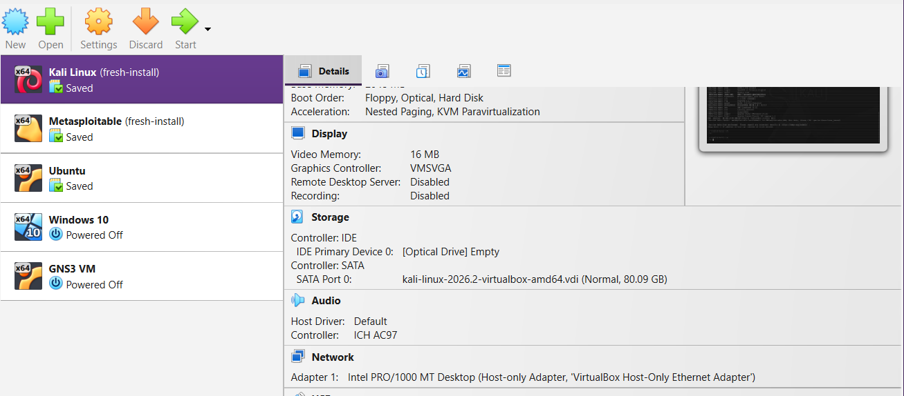
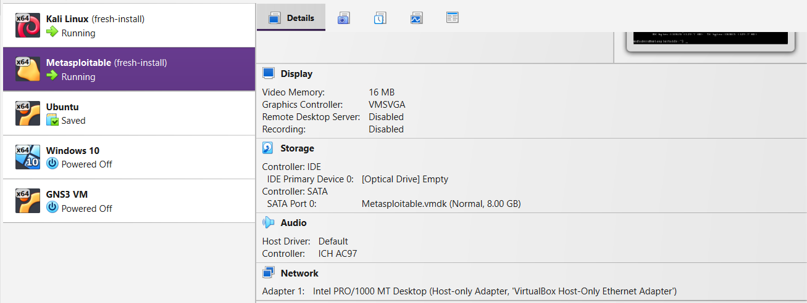
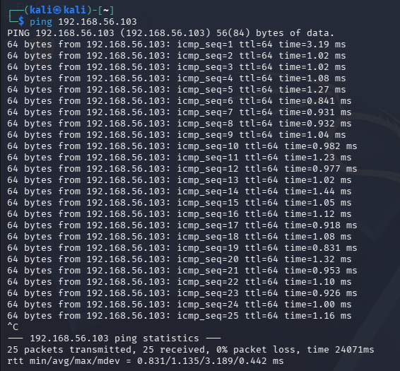
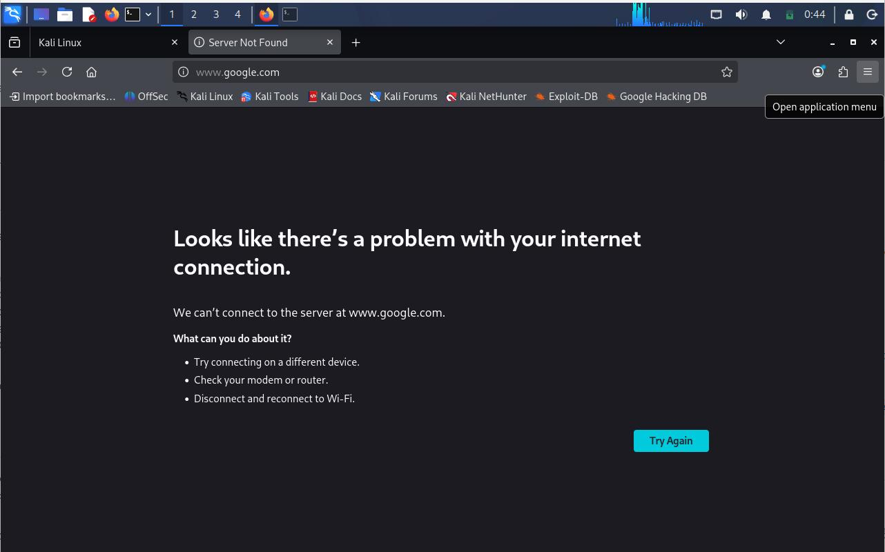
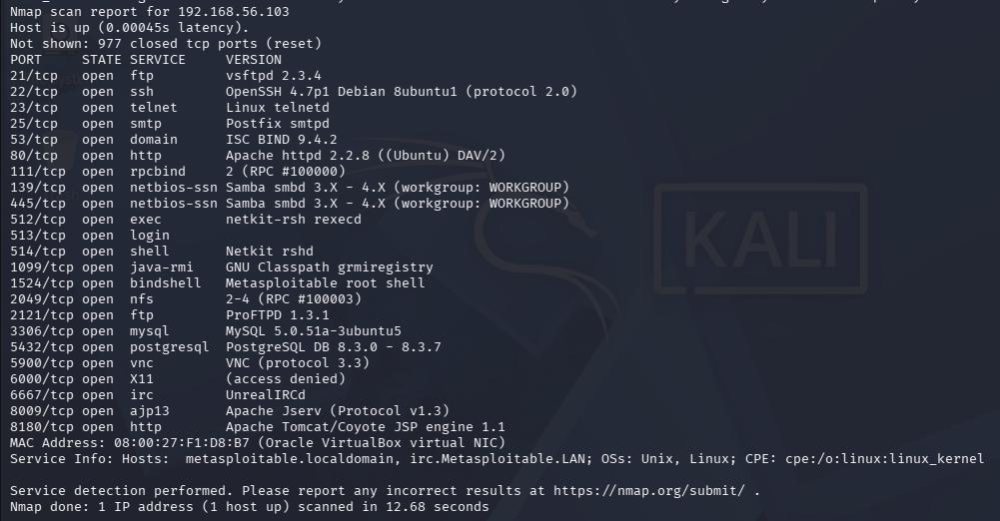

# Virtual Lab Setup and Nmap Service Scan

I built an isolated VirtualBox lab with Kali Linux as the attacker machine and Metasploitable 2 as a deliberately vulnerable target. I verified that the lab was isolated, then ran an Nmap service and version scan to see which services the target exposes and why they matter.

> **Authorisation:** all testing was done on virtual machines that I own, inside a host-only network with no internet access. Metasploitable 2 is intentionally vulnerable and must never be connected to a real network.

## Objective

Build a safe, isolated lab for practising security tools, prove that it is isolated, and use Nmap service detection to identify the services and software versions running on the target.

## Environment and tools

| Item | Value |
|---|---|
| Hypervisor | Oracle VirtualBox 7.2.8 |
| Attacker VM | Kali Linux 2026.2 (80 GB virtual disk) |
| Target VM | Metasploitable 2 (8 GB virtual disk) |
| Network | VirtualBox host-only adapter (Intel PRO/1000 MT Desktop), both VMs on the same adapter |
| Addresses | Kali: 192.168.56.102, Metasploitable 2: 192.168.56.103 |
| Tools | `ip addr show`, `ifconfig`, `ping`, Nmap 7.99 |

## Method

1. Set up two VMs in VirtualBox: Kali Linux (attacker) and Metasploitable 2 (target). I downloaded both from their official sources.
2. Set Adapter 1 of both VMs to the same **host-only** adapter, so they can reach each other but not my home network or the internet.
3. Started both VMs and confirmed their addresses with `ip addr show` on Kali and `ifconfig` on Metasploitable 2.
4. Tested connectivity with `ping 192.168.56.103` from Kali and `ping 192.168.56.102` from Metasploitable 2.
5. Tested isolation by trying to open `google.com` from Kali. The request failed, as expected.
6. Scanned the target from Kali with `nmap -sV 192.168.56.103`. The `-sV` option probes open ports to identify the service and version behind each one.
7. Reviewed the output and noted services that are outdated or risky if exposed.

## Results

### Lab verification

| Check | Result |
|---|---|
| Network adapter | Both VMs use the same host-only adapter (Figures 1 and 2) |
| IP configuration | Kali 192.168.56.102/24; Metasploitable 2 192.168.56.103, mask 255.255.255.0 (Figures 3 and 4) |
| Kali to target | 25 packets sent, 25 received, 0% loss, average 1.135 ms (Figure 5) |
| Target to Kali | 17 packets sent, 17 received, 0% loss, average 2.167 ms (Figure 6) |
| Internet isolation | `google.com` could not be reached from Kali (Figure 7) |

### Nmap scan

Command: `nmap -sV 192.168.56.103`

The host was up, with 23 open ports and 977 closed ports (the default scan covers the 1,000 most common ports). The scan finished in 12.68 seconds. The full output is in the evidence folder; notable services are below.

| Port | Service and version | Why it stands out |
|---|---|---|
| 21 | FTP, vsftpd 2.3.4 | Unencrypted protocol; this version is old |
| 23 | Telnet | Unencrypted remote access |
| 512, 513, 514 | rexec, rlogin, rsh | Legacy remote-shell services with weak authentication |
| 1524 | bindshell, "Metasploitable root shell" | Described by Nmap as a root shell |
| 2121 | FTP, ProFTPD 1.3.1 | A second, old FTP service |
| 80 | HTTP, Apache 2.2.8 | Old web server version |
| 8180 | HTTP, Apache Tomcat/Coyote JSP engine 1.1 | Application server exposed |
| 3306, 5432 | MySQL 5.0.51a, PostgreSQL 8.3.x | Databases listening on the network |
| 5900 | VNC (protocol 3.3) | Remote desktop exposed |
| 139, 445 | Samba smbd 3.X - 4.X | File sharing services exposed |

### What the results show, and what they don't

Many exposed services, several of them unencrypted or running old versions, show why vulnerability assessment matters. Nmap's version detection helps because it names the application and version, which lets an assessor look up known weaknesses.

A version string is not proof of a vulnerability. I did not test or exploit any of these services, so the table lists *reasons to investigate*, not confirmed findings. The scan also covered only the default 1,000 ports, so services on other ports would not appear.

## What I would do differently

**Fixing the issues on the target (in a real system):**
- Turn off services that aren't needed: Telnet, rexec, rlogin, rsh, VNC and the bindshell.
- Replace FTP and Telnet with SFTP and SSH, with strong authentication.
- Patch or upgrade outdated software. Metasploitable 2 is unsupported, so on a real host I would replace the whole operating system.
- Limit access with a host firewall and network segmentation, and expose databases only to the systems that need them.

**Improving the lab and method:**
- Save scan output to a file (`-oN` or `-oX`) so the evidence is reproducible, and record the Nmap version.
- Run a full-port scan (`-p-`) and add a Wireshark capture to see what the scan sends.
- Take VM snapshots before each exercise so the lab can be reset quickly.
- Add a Windows VM and a SIEM such as Wazuh to practise detection as well as scanning.
